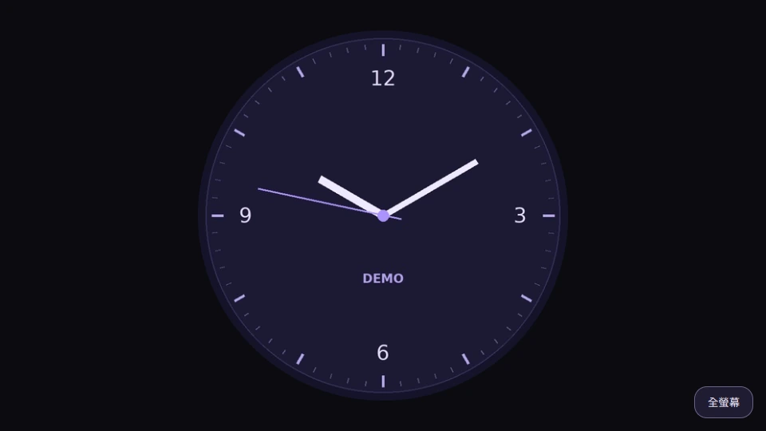

# Wear OS Screen mirroring

Mirror your Wear OS watch to a browser on the same Wi-Fi network. Open the viewer with a QR code or the address shown on the watch. To show it on a TV, connect the computer by HDMI or use your computer's supported casting feature.

[Download Wear Mirror v0.2 APK](downloads/WearMirror_v0.2.apk?raw=true)

## Browser viewer screenshot

The browser viewer is shown with a demo watch face. 實際投影時，呢度會顯示手錶嘅即時畫面。

## 用 Android 手機安裝 APK 到手錶

以下以 Galaxy Watch 同 AnExplorer 為例。手機端工具可用 [AnExplorer](https://anexplorer.io/install/apk-on-wear-os)、[Bugjaeger](https://sisik.eu/bugjaeger) 或 [Easy Fire Tools](https://play.google.com/store/apps/details?id=de.agondev.easyfiretools)。工具選單因版本而異。呢個方法透過手機 App 使用 **無線 ADB**，全程可以喺手機同手錶完成。

1. **下載 APK，同一個 Wi-Fi。** 喺 Android 手機下載 [WearMirror_v0.2.apk](downloads/WearMirror_v0.2.apk?raw=true)，再確認手機同手錶連接同一個 Wi-Fi。
2. **喺手錶啟用無線偵錯。** 到「設定 → 關於手錶 → 軟件資訊」，連續點按「軟件版本」直至開啟開發人員模式。返回「設定 → 開發人員選項」，開啟「無線偵錯（Wireless debugging）」。如果手錶要求先開啟「ADB 偵錯」，按提示開啟。
3. **用配對碼配對。** 喺手錶嘅「無線偵錯」頁撳 **Pair with pairing code**。喺手機工具嘅配對功能輸入手錶顯示嘅 IP 位址、**配對埠**同六位數配對碼。如果工具配對後要求另行連線，返回手錶嘅「無線偵錯」主頁，使用嗰頁顯示嘅 IP 位址同 **連線埠**。配對埠同連線埠可能唔同。
4. **推送並安裝。** 喺 AnExplorer 開啟 **Remote Install**，揀手錶，再揀已下載嘅 APK 並開始安裝。使用其他工具時，選擇相應嘅安裝 APK 功能。
5. **確認授權。** 如果手錶彈出「允許 ADB 偵錯？」提示，確認係你部手機發起嘅連線，再撳 **允許／OK**。安裝完成後，喺手錶應用程式清單開啟 **Wear Mirror**。完成安裝後可以關閉無線偵錯。

參考資料：[Android Developers 無線配對及連線指引](https://developer.android.com/training/wearables/get-started/debug-wifi) · [AnExplorer Wear OS 安裝指引](https://anexplorer.io/install/apk-on-wear-os)

## Quick start

1. Install the APK on your Wear OS watch. Wear Mirror requires Android API 30 or later and system screen capture support.
2. Connect the watch and your computer to the same Wi-Fi network.
3. Open Wear Mirror, tap **開始投影**, and approve the system screen capture prompt.
4. Scan the QR code or open the displayed address in the computer's browser. Use **全螢幕** to show the watch face full screen. Tap **停止投影** on the watch to end the session.

The viewer uses local HTTP. Use a trusted Wi-Fi network and share the session address only with your intended viewers.

## Build from source

Use Bash with JDK 17, Android SDK Platform 35, Build Tools 35.0.0, and the ZXing core 3.5.3 JAR. Set `JAVA_HOME`, `ANDROID_HOME`, and `ZXING_CORE_JAR` to their absolute paths. Set `WEAR_MIRROR_KEYSTORE` to your own signing keystore with alias `wearmirror`, and supply its password through `WEAR_MIRROR_STORE_PASSWORD`. Run `bash build.sh` from the checkout. The APK is written to a `deliverables` folder next to the checkout.

## 繁體中文

手錶同電腦連同一個 Wi-Fi。喺手錶開 Wear Mirror，撳「開始投影」同批准擷取螢幕。用電腦掃手錶上嘅 QR Code，或者喺瀏覽器輸入畫面顯示嘅網址。電腦可經 HDMI 或支援嘅無線投影功能接駁電視。
